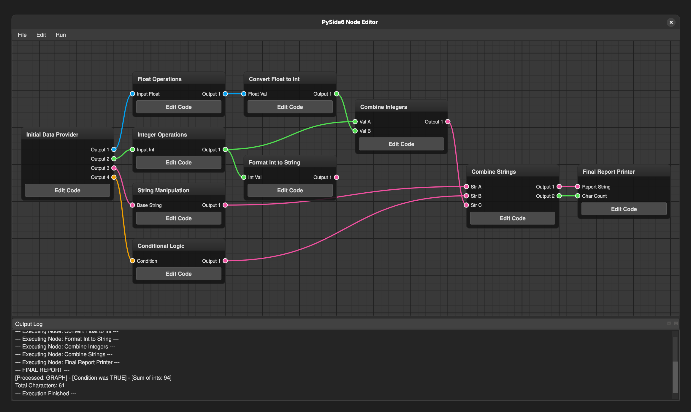
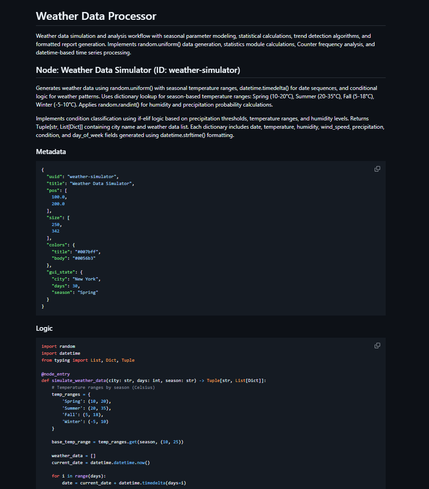
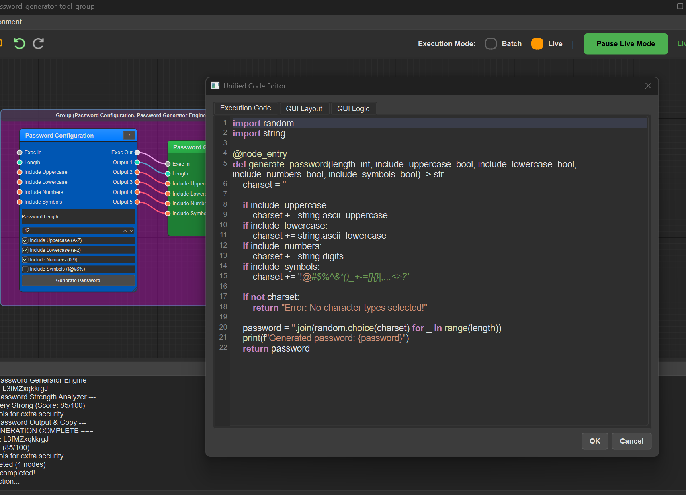
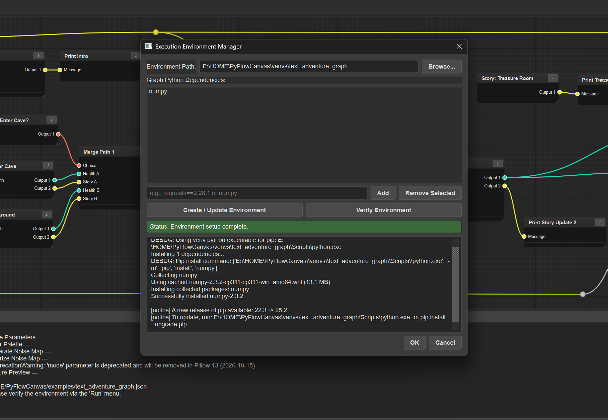
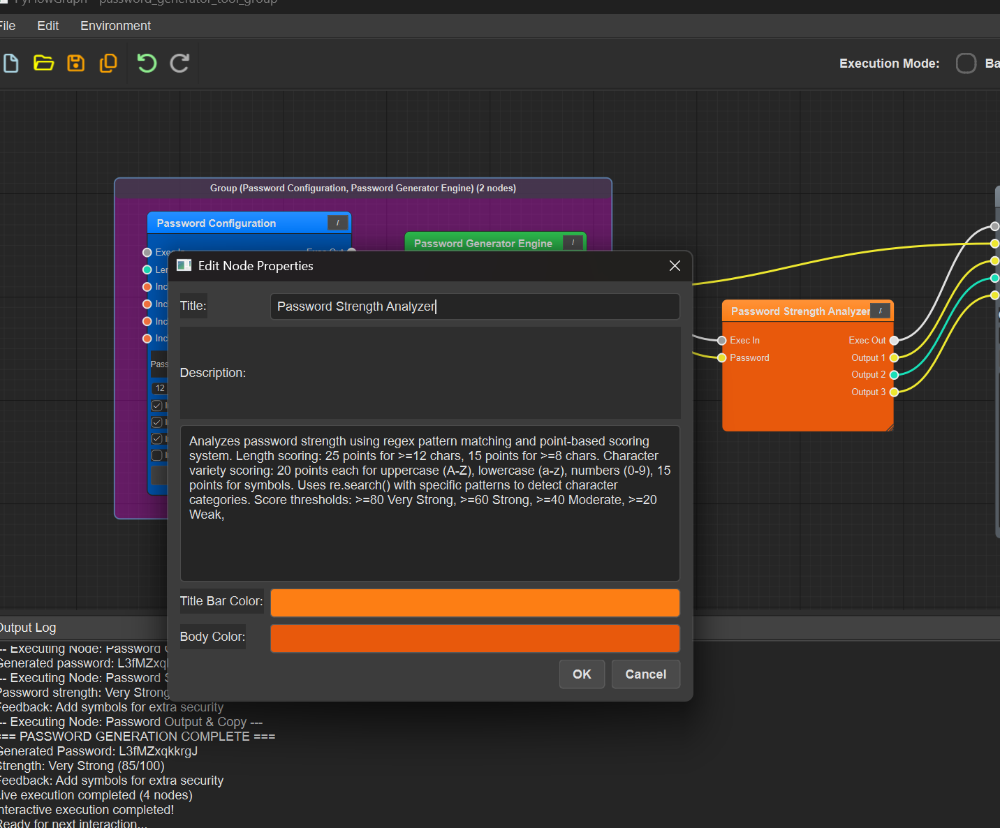
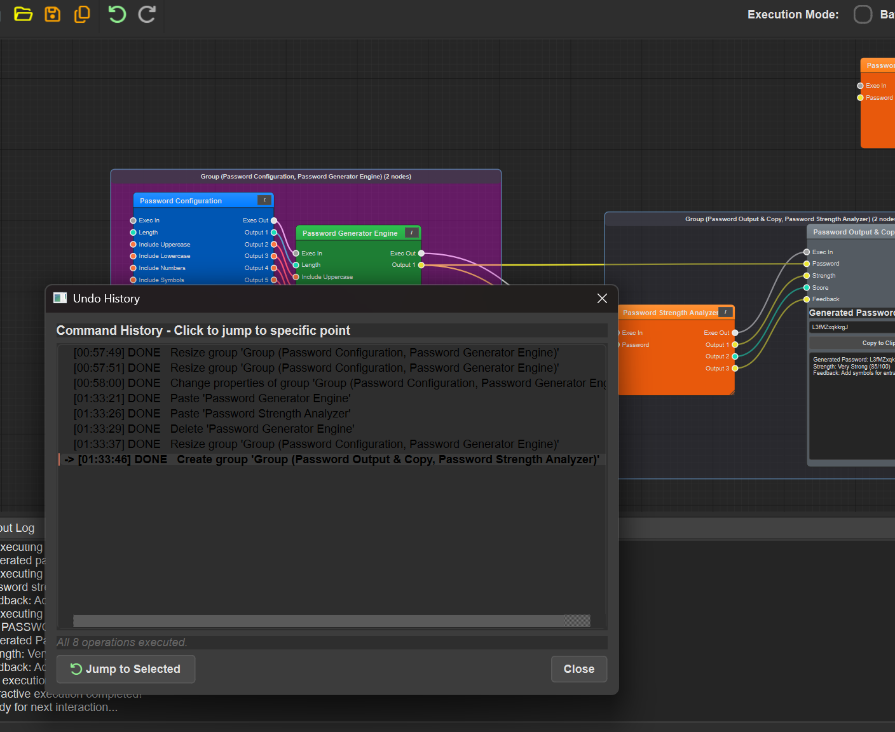

# PyFlowGraph

[](https://github.com/bhowiebkr/PyFlowGraph/actions/workflows/tests.yml)


A universal, node-based visual scripting editor built with Python and PySide6 that bridges traditional data-flow programming with interactive application development. Create, connect, and execute Python code as nodes using either batch processing for data pipelines or live event-driven execution for interactive applications.



> PyFlowGraph has a successor: [Patina](https://github.com/bhowiebkr/Patina), a node graph editor and engine in which each node is Rust code. Patina is at an early stage.
>
> For a small editor that is easy to read and learn from, see [Python Node Editor](https://github.com/bhowiebkr/python-node-editor).

PyFlowGraph implements a **hybrid execution model** that combines two powerful paradigms:

* **Batch Mode**: Traditional data-flow execution where the entire graph processes data sequentially based on dependencies - perfect for ETL pipelines, data transformations, API integrations, and automated workflows
* **Live Mode**: Event-driven interactive execution with persistent state and real-time event handling - ideal for building webhook handlers, real-time data processing, monitoring dashboards, and reactive automation systems

This dual approach makes PyFlowGraph uniquely versatile - use the same visual programming environment to build everything from complex workflow automations and API integrations to data transformation pipelines and business process automation. The application provides a Qt-based interface for creating and connecting Python functions as nodes in a directed graph, with automatic pin generation from function signatures and type annotations.

The core architecture follows a **"Code as Nodes"** philosophy where each node contains actual Python code that can be edited in a built-in IDE. Input and output pins are automatically generated by parsing function signatures and type hints, eliminating manual configuration while maintaining type safety. The innovative Markdown-based file format (.md) stores graphs in a human-readable format that can be version controlled, edited manually, and even processed by AI assistants and LLMs.

---

## Features

* **Dynamic Node Generation**: Pins are created automatically by parsing Python function signatures within each node. Type hints (`int`, `str`, `float`, `bool`, `Tuple`) define the data type and color of each pin.
* **Blueprint-Style Navigation**:
  * **Pan**: Right-click + Drag or Middle-click + Drag.
  * **Zoom**: Mouse Wheel Scroll.
  * **Select/Move**: Left-click to select and drag nodes.
* **Hybrid Execution Engine**:
  * **Batch Mode**: Traditional execution where the entire graph runs sequentially based on data dependencies
  * **Live Mode**: Interactive execution with real-time event handling and persistent state for building interactive applications
* **Event-Driven Interactive System**: Built-in event system supporting button clicks, timers, value changes, and user input for creating interactive experiences
* **Node Grouping System**: Visual containers for organizing related nodes with customizable colors, sizes, and transparency. Groups support dynamic membership, resizing, full CRUD operations with Delete key support, and complete undo/redo functionality.
* **Complete Undo/Redo System**: Command pattern implementation across all operations including node creation/deletion, connections, moves, property changes, and group operations. Multi-level undo with memory management and composite command support.
* **Graph Environments**: Each graph can use its own virtual environment with its own pip packages. Node code runs in the editor process, so it is not a sandbox.
* **Mini-IDE Code Editor**:
  * A modal dialog provides a spacious and professional coding environment.
  * **Syntax Highlighting** for Python with custom color schemes.
  * **Line Numbering** and **Smart Auto-Indentation**.
  * **Tab support** and professional editing features.
* **Advanced Connection Management**:
  * **Reroute Nodes**: Double-click a connection to create a reroute node for better graph organization.
  * **Connection Replacement**: Dragging a new wire to an already connected input pin automatically replaces the old connection.
  * **Type-Safe Connections**: Pin colors indicate data types for visual type checking.
* **Intelligent Clipboard System**:
  * Copy (`Ctrl+C`) and paste (`Ctrl+V`) multiple nodes and groups with preserved relationships.
  * Internal connections between copied nodes are maintained automatically.
  * Smart positioning system offsets pasted nodes based on cursor location.
  * Group-aware copy/paste operations maintain group membership.
* **Professional UI/UX**:
  * **Custom Dark Theme**: Consistent, modern QSS stylesheet throughout the application.
  * **Font Awesome Integration**: Professional iconography for all UI elements.
  * **Blueprint-Style Navigation**: Industry-standard node editor interaction patterns.
* **Robust Persistence**: Graphs serialize to human-readable Markdown format with embedded metadata, making files both machine-readable and easily editable by humans. Full state preservation including node positions, connections, code, group definitions, and environment requirements. All file operations use UTF-8 encoding for proper international character support.
* **Dynamic Interface**: Window title automatically updates to display the current graph name for better project identification.

---

## Markdown File Format

PyFlowGraph uses a innovative Markdown-based file format (`.md`) that combines human readability with structured data storage. This format makes graphs both machine-readable for the application and easily editable by humans or AI assistants. The format includes embedded metadata for node positions, connections, and execution requirements while presenting the code in a clean, readable format.



For detailed information about the file format specification, see [flow_spec.md](docs/specifications/flow_spec.md).

### Example Graphs

The `examples/` directory contains sample graphs demonstrating various capabilities:

* [`password_generator_tool_group.md`](examples/password_generator_tool_group.md) - Password generator with group organization demonstration
* [`recipe_nutrition_calculator.md`](examples/recipe_nutrition_calculator.md) - Recipe analysis and nutrition calculator
* [`weather_data_processor.md`](examples/weather_data_processor.md) - Weather data analysis and processing
* [`nvidia_gpu_computer_vision_pipeline.md`](examples/nvidia_gpu_computer_vision_pipeline.md) - Image processing with PyTorch. It needs a graph environment with `torch` and `torchvision`.

---

## Screenshots

### Mini-IDE Code Editor

The integrated Python code editor provides a professional development environment within PyFlowGraph. Features include syntax highlighting with custom color schemes, line numbering, smart auto-indentation, and tab support. The modal dialog design gives developers ample space to write and edit node logic while maintaining the visual context of the graph workflow.



### Python Environment Manager

The Python Environment Manager dialog enables sophisticated dependency management for each graph project. Users can specify custom pip requirements that are automatically installed in isolated virtual environments. This gives each graph its own packages and prevents conflicts between projects. It is not a sandbox: node code runs in the editor process.



### Node Properties Dialog

The Node Properties dialog provides comprehensive configuration options for individual nodes. Users can modify node appearance, behavior settings, and metadata through an intuitive interface. This dialog supports real-time property updates and integrates seamlessly with the undo/redo system for reliable editing workflows.



### Node History Dialog

The Node History dialog provides complete visibility into node evolution and changes over time. Users can review edit history, compare different versions of node code, and track modifications through an intuitive timeline interface. This feature supports development workflow tracking and enables easy rollback to previous node states.



## Project Structure

The project is organized into modular, single-responsibility Python files:

### Core Application Files
* `src/main.py`: Starts the editor. It loads the fonts and the stylesheet and sets the log level.
* `src/pyflowgraph/`: The editor package. `pyproject.toml` describes it and lists its dependencies.
* `dark_theme.qss`: The global Qt Style Sheet that defines the application's dark theme.
* `src/resources/`: The Font Awesome fonts.

### Core Engine (`src/pyflowgraph/core/`)
* `node_graph.py`: The `QGraphicsScene` that manages all nodes, connections, groups, and clipboard logic.
* `node.py`: Defines the main Node class, including visual appearance and Python code parsing for pin generation.
* `pin.py`: Defines the input/output pins on nodes with type-safe connections.
* `connection.py`: Defines the visual Bezier curve connections between pins.
* `reroute_node.py`: Special organizational nodes for managing connection routing.
* `group.py`: Visual container system for organizing related nodes with customizable appearance.

### User Interface (`src/pyflowgraph/ui/`)
* `editor/node_editor_window.py`: Main `QMainWindow` hosting all UI elements.
* `editor/node_editor_view.py`: `QGraphicsView` handling mouse/keyboard interactions (pan, zoom, copy/paste).
* `dialogs/`: All dialog components including code editor, settings, node properties, and group management.
* `code_editing/`: Python code editor with syntax highlighting and smart indentation.

### Execution & Environment (`src/pyflowgraph/execution/`)
* `graph_executor.py`: Engine that executes node graphs based on data dependencies.
* `single_process_executor.py`: Runs node code in the editor process and keeps the imported modules between runs.
* `environment_manager.py`: Virtual environment management for graph-specific dependencies.
* `default_environment_manager.py`: Makes the default environment. venv and pip run in a worker thread.
* `execution_controller.py`: Controls batch and live mode execution.

### Command System (`src/pyflowgraph/commands/`)
* Command pattern implementation for comprehensive undo/redo functionality
* `node/`: Node-specific operations (create, delete, move, property changes)
* Group commands: create, delete, resize, property management
* Connection and reroute commands with full state preservation

### Utilities & Configuration
* `src/pyflowgraph/utils/color_utils.py`: Color manipulation utilities for the interface.
* `src/pyflowgraph/settings.py` and `paths.py`: The settings file and the folders of the program.
* `PyFlowGraph.bat`: starts the editor with the Python in the `venv` folder.
* `tools/run_tests.py`: runs each test file in its own process.

---

## Running the Pre-compiled Version (Windows)

This is the easiest way to run the application without needing to install Python or any dependencies.

1. **Go to the [Releases Page](https://github.com/bhowiebkr/PyFlowGraph/releases)** on GitHub.
2. Find the latest release and download the `.zip` file, such as `PyFlowGraph-Windows-v1.0.0.zip`.
3. **Unzip** the downloaded file to a location of your choice. This will create a new folder.
4. Open the new folder and run `PyFlowGraph.exe`.
5. To test the application, click **File > Load Graph...** and open one of the `.md` files from the `examples` folder.

---

## Setup and Installation

1. **Clone the Repository**:

    ```bash
    git clone https://github.com/bhowiebkr/PyFlowGraph.git
    cd PyFlowGraph
    ```

2. **Create a Virtual Environment**:

    ```bash
    python3 -m venv venv
    ```

3. **Activate the Environment**:
    * On Linux/macOS: `source venv/bin/activate`
    * On Windows: `venv\Scripts\activate`

4. **Install the Program and Its Dependencies**:

    ```bash
    pip install -e .
    ```

    `pyproject.toml` lists the exact versions.

5. **Run the Application**:

    **Windows:**

    ```cmd
    PyFlowGraph.bat
    ```

    **Linux/macOS:**

    ```bash
    python src/main.py
    ```

    To see the debug messages, set the `PYFLOWGRAPH_LOG_LEVEL` environment variable to `DEBUG`
    before you start the program.

---

## Quick Start Guide

### Basic Operations

* **Create a Node**: Right-click on the canvas and select **Add Node**
* **Edit Node Logic**: Click the **</>** button on a node to open the integrated code editor
* **Connect Nodes**: Click and drag from an output pin (right side) to an input pin (left side)
* **Navigate**:
  * **Pan**: Right-click + drag or middle-click + drag
  * **Zoom**: Mouse wheel scroll
  * **Select/Move**: Left-click to select and drag nodes
* **Delete Items**: Select any node, reroute node, connection, or group and press `Delete`
* **Execute Graph**:
  * **Batch Mode**: Select **Batch** and click **Execute Graph**, or press `F5`
  * **Live Mode**: Select **Live** and click **Start Live Mode** for interactive execution

### Execution Modes

* **Batch Mode**: Execute entire graph at once with traditional data-flow execution
* **Live Mode**: Interactive mode with persistent state and event-driven execution for building interactive applications
* **Event System**: Built-in support for user interactions, timers, and custom triggers within nodes

### Advanced Features

* **Node Grouping**: Select nodes, right-click and select **Group Selected** to create groups for organizing nodes with custom colors and properties
* **Reroute Connections**: Double-click any connection to create an organizational reroute node
* **Copy/Paste**: Use `Ctrl+C` and `Ctrl+V` to duplicate node selections and groups with preserved connections
* **Undo/Redo**: Full `Ctrl+Z` and `Ctrl+Y` support for all operations including groups, moves, and property changes
* **Environment Management**: Click **Environment > Manage Environment...** to configure pip dependencies
* **Save/Load**: Use "File" menu to save graphs as Markdown or load example projects
* **Dynamic Window Titles**: Window title automatically updates to show the current graph name

### Open Graphs from Other People

A graph file is a program. The **GUI Definition** and **GUI State Handler** code of its nodes
runs when the graph opens. The other node code runs when you run the graph.

When a graph has this code and you have not trusted it, the editor asks first:

1. Click **File > Load Graph...**.
2. Select the file.
3. Read the list of nodes in **Run Code from This Graph?**.
4. Click **Open and Trust** only if you trust where the file came from. Click **Cancel** to
   leave it closed.

The editor remembers your choice until the file changes. It trusts the bundled examples and the
files that you save. At startup it reopens the last graph only if the graph is trusted.

When you paste nodes with this code from outside the editor, it asks **Run Code from the
Clipboard?**. Click **Paste and Run** to paste them.

### Testing the Application

1. Load an example: click **File > Load Graph...** and select from the `examples/` folder
2. Select execution mode: **Batch Mode** for traditional execution or **Live Mode** for interactive applications
3. Press `F5` (Batch) or click **Start Live Mode** (Live) to execute and see results in the Output Log panel
4. Notice how the window title updates to show the current graph name

---

## Node Scripting Guide

The power of this editor comes from its function-based node definition. The editor parses the first function it finds in a node's code to determine its I/O pins.

### Defining Inputs

Inputs are defined as parameters to your function. The parameter's **name** and **type hint** are used to create the input pin.

```python
# This creates an input pin named "Input Number" of type Float.
def my_function(input_number: float):
    ...
```

### Defining Outputs

Outputs are defined by the function's **return type hint**.

**Single Output:**

```python
# This creates a single output pin named "Output 1" of type String.
def my_function(input_value: int) -> str:
    return f"The value is {input_value}"
```

**Multiple Outputs:**
Use a `Tuple` to define multiple output pins. The editor will create `output_1`, `output_2`, etc.

```python
from typing import Tuple

# Creates two output pins:
# - "Output 1" (String)
# - "Output 2" (Integer)
def my_function(input_value: str) -> Tuple[str, int]:
    return f"Processed: {input_value}", len(input_value)
```

### Helper Functions & Imports

You can define helper functions and import modules at the top level of your code. They will be available to your main node function during execution.

```python
import random

def get_random_suffix() -> str:
    return str(random.randint(100, 999))

def main_node_function(base_name: str) -> str:
    suffix = get_random_suffix()
    return f"{base_name}_{suffix}"
```

### Advanced Features

**Custom Dependencies**: Each graph can specify its own pip requirements through the Environment Manager. Dependencies are automatically installed in isolated virtual environments. Each entry must be one package, such as `numpy>=1.24`. The setup stops when an entry is a pip option, such as `--index-url`.

**Type Flexibility**: The editor supports any Python type through type hints for automatic pin generation. Pin colors are determined by the type annotation, providing visual type identification. Common types include:

* `int` - Integer values (blue pins)
* `str` - String values (green pins)
* `float` - Floating point numbers (orange pins)
* `bool` - Boolean values (red pins)
* `Tuple[type, ...]` - Multiple outputs (colored by constituent types)
* Custom classes, complex data structures, and any Python object are fully supported

**Error Handling**: Node execution errors are captured and displayed in the Output Log with full stack traces for debugging.

---

## Virtual Environment Management

PyFlowGraph features advanced virtual environment management:

* **Isolated Environments**: Each graph can have its own virtual environment with custom pip dependencies
* **Automatic Management**: The application creates project-specific environments in the `venvs/` directory
* **Environment Dialog**: Click **Environment > Manage Environment...** to configure package dependencies for each graph
* **Not a sandbox**: Node code runs in the editor process, with the packages of the graph's environment. Trust only graphs whose source you trust.

---

## Testing

Run each test file in its own process, with a limit of 10 seconds for each file:

```bash
python tools/run_tests.py
```

[CONTRIBUTING.md](CONTRIBUTING.md#run-the-tests) tells more. [STATUS.md](STATUS.md) has the result of the last full run.

---

## Documentation

[docs/README.md](docs/README.md) lists the documentation pages:

* **[Flow Specification](docs/specifications/flow_spec.md)** - the Markdown graph format
* **[Development Roadmap](docs/roadmap.md)** - planned features
* **[Bug Reports](docs/bugs/)** - bug reports that sync with GitHub Issues
* **[CONTRIBUTING.md](CONTRIBUTING.md)** - set up, run the tests and report a problem

---

## Development Roadmap

### Recently Completed
* **Undo/Redo System** - Complete multi-level undo/redo with Command Pattern
* **Node Grouping** - Visual containers for organizing nodes with full CRUD operations
* **Single Process Execution** - Node code runs in the editor process and keeps imported modules between runs

### Priority 1: Usability
* **Pin Type Visibility** - Type badges and connection compatibility highlighting

### Priority 2: Advanced Features
* **Enhanced Debugging** - Breakpoints, step-through execution, live data inspection
* **Group Templates** - Save and reuse common node group patterns

See [full roadmap](docs/roadmap.md) for complete details.

---

## Known Issues

Active bugs are tracked in both local documentation and GitHub Issues:
* **Bug Reports**: Located in `docs/bugs/` directory
* **GitHub Issues**: [Project issue tracker](https://github.com/bhowiebkr/PyFlowGraph/issues)

[STATUS.md](STATUS.md) lists the known problems and the known limits.

---

## Dependencies

* **Python 3.11 or newer**
* **PySide6** - Qt6 framework for Python
* **Font Awesome** - Professional iconography (included in `src/resources/`)

---

## Contributing

Bug reports, feature requests and pull requests are welcome, from people and from their AI
agents. [CONTRIBUTING.md](CONTRIBUTING.md) tells how to set up, run the tests and report a
problem. [STATUS.md](STATUS.md) lists what was checked, the known problems and the known limits.
Report a security problem privately, as [SECURITY.md](SECURITY.md) tells.

---

## License

This project is licensed under the MIT License. See the `LICENSE.txt` file for details.

---

## Support

<div align="center">

[](https://buymeacoffee.com/bryanhoward)

*If PyFlowGraph has been helpful to you, consider supporting its development!*

</div>
